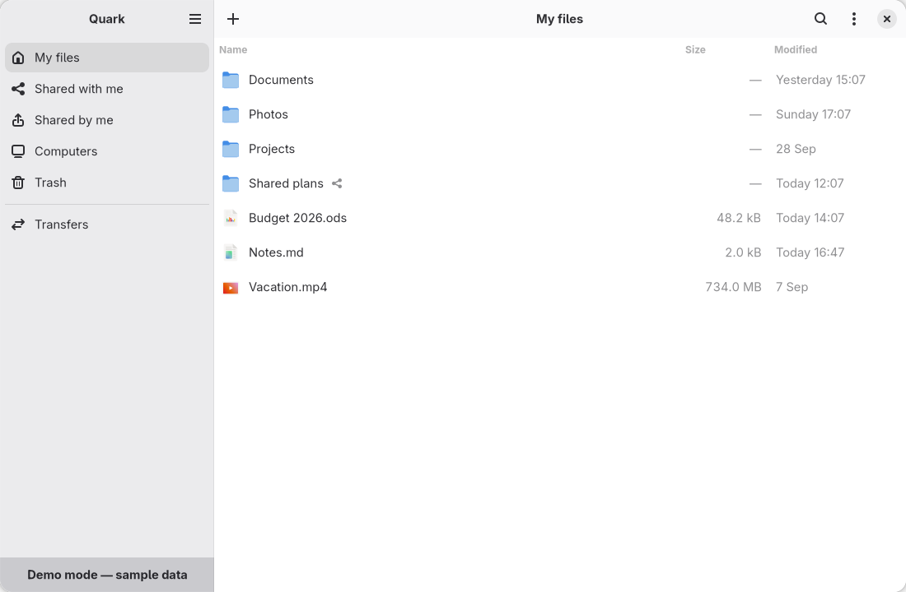

# Quark

[](https://github.com/HydroshieldMKII/Quark/actions/workflows/ci.yml)
[](https://github.com/HydroshieldMKII/Quark/releases)
[](LICENSE)

Unofficial GNOME client for [Proton Drive](https://proton.me/drive), written in Go with GTK 4 and
libadwaita. It drives the official [Proton Drive CLI](https://proton.me/support/drive-cli) and
never handles credentials. Not affiliated with Proton AG.



## Features

- Browse, upload, download, rename, move, copy, trash, restore and share files
- Background transfers with a panel status icon
- [`quark-mount`](docs/MOUNT.md): Proton Drive as a folder, with offline pins and two-way sync
- English and French

## Install

Requires Linux with GNOME 50 and the `proton-drive` CLI (`proton-drive auth login`).

- **Folder mount**: download `quark-mount` from the [latest release](https://github.com/HydroshieldMKII/Quark/releases) and follow [`docs/MOUNT.md`](docs/MOUNT.md).
- **GNOME app**, from source:

  ```bash
  sudo dnf install golang gcc gtk4-devel libadwaita-devel gobject-introspection-devel
  make build && ./bin/quark --demo
  ```

## Documentation

[Mount](docs/MOUNT.md) · [Troubleshooting](docs/TROUBLESHOOTING.md) · [Architecture](docs/ARCHITECTURE.md) · [Decisions](docs/DECISIONS.md) · [Testing](docs/TESTING.md) · [Contributing](CONTRIBUTING.md) · [Releasing](docs/RELEASING.md) · [Security](SECURITY.md)

## License

GPL-3.0-or-later. See [`LICENSE`](LICENSE).
